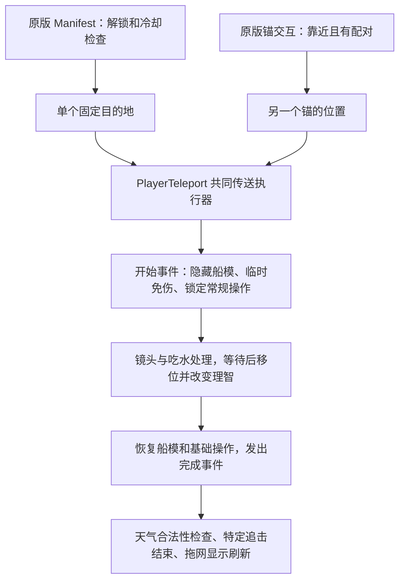

# 传送机制研究与方案比较

日期：2026-10-17（Asia/Shanghai）
范围：本目录 DREDGE Mac 内容包；只读分析原包，保存研究结果。用户已确认本轮只研究和推荐，未授权实现。
状态：代码与配置研究；尚未进行游戏内传送、物理碰撞、输入或保存再读档验证。

## 结论

**优先推荐独立的商人固定目的地扩展。** 保留原黑石岛传送和金船锚，让新增入口读取“原传送已解锁”和“这个商人已正常停靠”的状态，再使用原生传送执行器。固定落点数量有限，较容易逐个验证；用户提出的多点自设锚需要另建端点、配对、回收与持久化系统，不能直接复制原版锚。

“不破坏任务、原技能和存档结构”可以成为实现与验收目标；“完全不改变原有难度”不能承诺。省去航程会减少时间、途中危险与鱼货变质机会；原生传送本身也会扣理智并联动天气、追击和拖网。推荐的限制用于减少影响，不代表已经证明没有影响。

现有[传送扩展计划书](传送扩展计划书.md)属于历史草案，其六目的地、默认无冷却、轮盘克隆等选择未获本轮确认；本报告第六节列出需纠正的内容。

## 一 两种原版传送分别做了什么

| 项目 | 黑石岛 Manifest | 冰川 DLC 金船锚 |
|---|---|---|
| 使用入口 | 选中技能后施法；受技能条和输入状态控制 | 靠近已配对的锚后长按交互 |
| 目的地 | 场景中标记为 `TeleportDestination` 的一个固定对象 | 另一个锚对象的位置 |
| 连接模式 | 可用航行状态下，从当前位置回固定点 | 一个固定端与一个可搬动端双向往返 |
| 施法或交互等待 | 资产 `castTime=1` 秒 | 代码长按 `0.5` 秒 |
| 共同传送演出 | 执行器移位前等 1 秒、移位后等 0.5 秒；使用受 `timeScale` 影响的时间 | 同左；这些时间来自 `PlayerTeleport` 资产 |
| 理智变化 | `-0.4`，按 0–1 量表减 40 个百分点 | `-0.5`，减 50 个百分点 |
| 冷却 | `0.5` 游戏日，约 12 个游戏小时；时间由原游戏推进 | 该交互路径未走技能冷却 |
| 持久化 | 已解锁技能、施法历史；共用执行器还会写理智 | 一个“已放置”布尔值与一组 X/Z 坐标；背包物品、理智也按原生流程改变 |
| 能否原样扩成多点 | 需要新增目的地选择与安全判断 | 不能；原配对算法和存档都是双点用途 |

理智变化是相加再限制在 0–1；低于所需数值也没有在这两个执行入口中看到“理智不足禁止传送”的检查，不能自行把数值解释成比例扣除或回理智。[PlayerSanity.cs](evidence/teleport-2026-10-17/decompiled/PlayerSanity.cs) 63–67 行；[配置证据](evidence/teleport-2026-10-17/assets-config-scene.json)。

### 黑石岛的解锁与调用路径

实际编译对话中，`Collector_AwardLogic` 检查 `relics-handed-in == 2`，进入 `Collector_Award2Manifest`，先推进世界阶段，再执行 `UnlockAbility manifest`。后续第三、第四奖励节点也包含该解锁命令。因此扩展应读取原版解锁状态，不能替玩家推进遗物、世界阶段或写解锁标志。[对话指令证据](evidence/teleport-2026-10-17/assets-yarn-unlock.json)；[PlayerAbilityManager.cs](evidence/teleport-2026-10-17/decompiled/PlayerAbilityManager.cs) 100–106、136–154 行。

`TeleportAbility.Init` 按标签取得固定目的地；`Activate` 把目的地、理智值与技能对象交给 `PlayerTeleport`。距离超过资产值 350 时还会设置 Manifest 成就。选择界面、技能解锁、冷却校验与施法历史属于外层，通用执行器不会自动承担这些规则。[TeleportAbility.cs](evidence/teleport-2026-10-17/decompiled/TeleportAbility.cs) 27–47 行；[AbilityBarUI.cs](evidence/teleport-2026-10-17/decompiled/AbilityBarUI.cs) 232–294 行。

静态变换合成的原目标为 `(80, 0, -100)`；这是原场景的资源位置，不是商人新落点的安全依据。复制同一个标签也不会自动产生“选任意商人”的功能。

### 金船锚的部署 配对与回收

金锚物品需要 DLC1 资格，占 1×2 两格，使用特殊“扔下船”动作；库存物品移除后，`ItemLogicHandler` 在船当前位置创建可回收端，并保存坐标。固定端位于黑石岛附近，资产 `canBeRetrieved=0`，静态世界坐标约 `(62, 0, -115)`。[资产证据](evidence/teleport-2026-10-17/assets-config-scene.json)；[GridManager.cs](evidence/teleport-2026-10-17/decompiled/GridManager.cs) 964–979 行；[ItemLogicHandler.cs](evidence/teleport-2026-10-17/decompiled/ItemLogicHandler.cs) 108–143 行。

每个锚在激活对象中查找第一个“不是自身、没有待删除”的锚，没有网络 ID 或目标列表。任何锚移除时，所有监听者都清空配对；读档只根据一组 X/Z 重建一个可搬动端。多复制几个对象会造成配对不明确、回收后其它端失联，以及重读只恢复一个点的问题。[TeleportAnchorPOI.cs](evidence/teleport-2026-10-17/decompiled/TeleportAnchorPOI.cs) 43–78 行；[SaveData.cs](evidence/teleport-2026-10-17/decompiled/SaveData.cs) 135–141、1494–1512 行；[GameSceneInitializer.cs](evidence/teleport-2026-10-17/decompiled/GameSceneInitializer.cs) 119–126 行。

回收须先确认背包装得下，成功后才删除海面端点和清“已放置”标志。靠近已配对锚时，它在交互选择中优先于码头、采集和调查；直接把原锚放在商人靠泊范围内可能抢走原有交互。[TeleportAnchorPOIHandler.cs](evidence/teleport-2026-10-17/decompiled/TeleportAnchorPOIHandler.cs) 30–41、52–112 行；[PlayerPOIInteraction.cs](evidence/teleport-2026-10-17/decompiled/PlayerPOIInteraction.cs) 126–171 行。

金锚也有原本的剧情门槛。实际采集点 `893` 初始库存为 0、上限 1、不自动补货。冰川对应剧情推进 `TPRWorldPhase` 后，在阶段 **≥4** 的分支选择结局动画；四个可能的最终事件均连接到共同的 DLC1 结局 Timeline，其中的信号调用 `DLC1FinaleScript.AddStock()`，给这个金锚采集点增加 1 件库存。玩家之后仍需正常打捞取得，不能把“拥有 DLC”当成“已经获得锚”。这是代码、对话指令与资源绑定的静态闭合证据，未观察实际播放或领取。[奖励链证据](evidence/teleport-2026-10-17/assets-anchor-unlock.json)；[DLC1FinaleScript.cs](evidence/teleport-2026-10-17/decompiled/DLC1FinaleScript.cs) 28–29、90–93 行。

该奖励信号位于共同 Timeline 的第 7.833333 秒，不能把它解释为从对话开始起的总等待时间。读档时阶段 ≥4 的 `SkipToFinalState` 只恢复结局外观，并不在该方法内重复补库存；后续实现不得重播奖励链、替玩家创建锚物品或推进阶段。

## 二 可复用的模式

可以提炼为四层：**目的地来源 → 使用条件 → 共同传送过程 → 持久化与世界联动**。两种原版方案主要在第一层与第四层的端点记录方式不同。新增固定商人或多锚网络，应把新的目的地与条件放在独立层；共用原生执行器的演出和事件，不改原 Manifest 的固定目标、不混入原锚配对集合。

`PlayerTeleport` 是执行器，不是安全入口：它不查任务进度、DLC、冷却、存活、停靠、目标碰撞或是否已在传送；结束时直接设“可移动、非临时免伤、基础输入层”，没有保存并还原任意调用前状态。[PlayerTeleport.cs](evidence/teleport-2026-10-17/decompiled/PlayerTeleport.cs) 29–71 行。传入空技能对象仅省略结束时停用该技能的调用，不会自动继承 Manifest 的解锁、冷却或成就判断。

## 三 必须保留并验证的原生关联

| 关联 | 已确认行为 | 对扩展的约束 |
|---|---|---|
| 时间和经济 | 执行器没有按路程补扣航行时间；时间由移动、捕鱼和其它推进方式决定 | 传送减少航程的经济与风险影响是设计取舍，不能称为纯外观修改 |
| 理智和存档 | `ChangeSanity` 写 `SaveData.Sanity` | 可以不新增原生存档字段，不能称“零写档影响” |
| 天气 | 只在当前天气不适用于目的区域时重抽；重抽会写天气状态并使用原生随机数 | 保留原事件；不能保证每传一次都重抽或一定下雪 |
| 追击 | 利维坦开始事件标记玩家已传走，完成事件结束该事件；另有特定怪物重置检测 | 增加目的地会增强逃离能力；不能概括成所有敌人都被清除 |
| 拖网 | 完成时刷新部署状态和内容显示，相关方法本身不等于收网 | 不能替玩家清空鱼货或强行收网；还须结合能力配置与实机行为 |
| 停靠和读档 | 正常停靠写已访问标志、码头与泊位；读档按码头/泊位创建玩家 | 传到外侧水面后仍走正常靠泊；不得伪造已停靠来强行保存目标 |
| 终局 | 终局航行开始冻结时间并禁保存；技能条在后续终局过场开始时禁施法 | 建议扩展从终局航行开始即禁用，这是更严格的新增保护规则 |

依据：[TimeController.cs](evidence/teleport-2026-10-17/decompiled/TimeController.cs) 98–206 行；[WeatherController.cs](evidence/teleport-2026-10-17/decompiled/WeatherController.cs) 247–291、505–510 行；[LeviathanWorldEvent.cs](evidence/teleport-2026-10-17/decompiled/LeviathanWorldEvent.cs) 188–201 行；[TrawlNetAbility.cs](evidence/teleport-2026-10-17/decompiled/TrawlNetAbility.cs) 279–303 行；[Player.cs](evidence/teleport-2026-10-17/decompiled/Player.cs) 320–358 行；[DredgeDialogueRunner.cs](evidence/teleport-2026-10-17/decompiled/DredgeDialogueRunner.cs) 808–819 行。

两个需要实际验收的具体风险：

- **停靠途中仍会自动移动。** `PlayerController` 的自动移动分支优先于“是否允许移动”；只判断 `IsDocked=false` 不够。必须排除正在靠泊、自动移动和自动旋转。[DockPOIHandler.cs](evidence/teleport-2026-10-17/decompiled/DockPOIHandler.cs) 154–179 行；[PlayerController.cs](evidence/teleport-2026-10-17/decompiled/PlayerController.cs) 153–171 行。
- **落地触发对白与传送结束可能冲突。** 剧情触发体进入时可开启对白并切对话输入层，而传送移位后等待结束又会切回基础层。该冲突是静态代码显示的可能路径，尚未实机复现；安全落点必须避开或专项验证这些触发体，不能关闭剧情来掩盖问题。[InspectPOIHandler.cs](evidence/teleport-2026-10-17/decompiled/InspectPOIHandler.cs) 71–94 行；`PlayerTeleport.cs` 57–71 行。

## 四 两个扩展方案的取舍

| 比较 | 商人固定目的地 | 自设多锚网络 |
|---|---|---|
| 符合的体验 | 航行中选一个商人，抵达其外侧安全水面 | 亲自布点、命名、连接，再使用自己的路线 |
| 可复用部分 | 共同执行器、原传送表现、码头数据 | 共同执行器、锚的视觉与近距离交互思路 |
| 必须新增 | 目的地目录、资格与访问检查、落点验证、独立入口与冷却 | 另加多端点数据、目标选择、部署回收、失效节点处理、存档迁移和恢复 |
| 对原机制的主要风险 | 未探索先抵达、绕过航程、码头交互或剧情体冲突 | 原锚串线、库存复制或丢失、跨存档串点、任意坐标绕过冰区/剧情边界 |
| 验证范围 | 有限且固定的商人落点 | 玩家可能放置的广泛场景和多种节点生命周期 |
| 推荐顺序 | 第一阶段候选 | 若布置航路本身是主要乐趣，再作为单独功能实现 |

实际资源确认 **4 个本体流浪商人 + 1 个冰川入口商人**：`dock.pontoon-gc`、`dock.pontoon-sb`、`dock.pontoon-ts`、`dock.pontoon-ds`、`dock.pontoon-tpr`。四个本体商人的 DockData 对话入口为 `TravellingMerchant_Root`，冰川为 `DLC1_TravellingMerchant_Root`。油井不是这五个流浪商人，旧草案将它加入六目的地属于额外范围；本轮不把它纳入推荐首期。[商人目录证据](evidence/teleport-2026-10-17/assets-config-scene.json)。

如果以后选择多锚方案，建议保留原金锚，另建独立端点表（稳定 ID、位置、所属存档、名称和有效性），使用独立组件与交互事件，避免继承 `TeleportAnchorPOI` 后被原版搜索收进去。新增数据存独立文件，须处理新开档、换槽、删除存档和恢复旧备份，不能仅用一个全局坐标列表。原生地图没有由现有锚坐标自动生成多目标选择器的已确认路径，需要作为新增界面处理。

## 五 推荐的固定商人版边界

以下均为建议，尚未实现或获准成为最终产品规格：

1. **进度保留。** 正常解锁 Manifest 后才开放；商人只开放原本已停靠的地点，读取 `has-visited-dock-*` 而不替玩家写它；冰川额外检查 DLC1 与场景有效性。已访问只能降低剧情跳跃风险，不能证明该处没有后续条件事件。
2. **自由航行使用。** “任意位置”收窄为允许普通航行的状态：排除死亡、停靠及靠泊途中、自动移动、捕鱼、暂停、对白、弹窗、过场、强制时间推进、终局和传送中。打开选择器与最终确认时各检查一次，失败不扣费、不移动。
3. **验证后的外侧落点。** 码头槽位只是定位参考；逐点核验水深、船体净空、惯性、朝向、能否驶离与靠泊、剧情触发体以及区域切换。`GetZoneForPoint` 只判断区域，不能证明是安全水域。原执行器不替扩展设置船头或清刚体速度。
4. **成本可见。** 建议以原版 1 秒施法、0.4 理智与半游戏日冷却作初始参照，并读取该构建的实际配置。新增冷却按存档保存在独立文件，不挪用原 `manifest` 历史键。独立冷却仍会增加总可用传送机会；若希望两入口共享冷却，便会改变原技能的可用时间，必须作为明确取舍另行确认。
5. **原内容独立。** 不更改原传送目标、原锚数量/回收规则、遗物和 DLC 任务，不创造物品、不解锁地图或码头。新选择界面不直接运行原技能轮盘逻辑；具体外观与输入设计留到实施阶段。
6. **可关闭不等于撤销进度。** 新功能应能可靠禁用，缺失或损坏设置时按关闭处理；独立测试副本先用测试存档。关闭可以停止未来传送，不能倒退已经发生的理智、时间、任务或保存进度，完整撤回须使用预先备份。

第一期不推荐冰川内部泊位或任意海面坐标。原代码甚至包含 `dock.tpr-south` 无破冰船时的读档防卡死补救，说明“场景中有码头”并不等于当前装备和剧情可以安全抵达。[SaveData.cs](evidence/teleport-2026-10-17/decompiled/SaveData.cs) 786–791 行。

## 六 对历史计划书的校正

| 原草案说法 | 本轮核查结果 |
|---|---|
| 冷却关闭时零写 SaveData | 不正确：原生理智和可能的天气变化仍写 SaveData；应约束“不添加自定义原生字段” |
| 码头泊位天然安全，forward 可推离岸方向 | 证据不足：原代码用正反方向中更接近当前船头的一边；偏移 3 米没有安全证明 |
| 每次传送重抽天气、到冰川自动切雪 | 过强：仅当前天气不合法时更换；是否下雪由合法天气配置与选择决定 |
| 锚点负数可能回理智，需运行探针才判方向 | 代码已确认负数扣除；实机只用于验证实际表现与链路 |
| 原轮盘固定 10 格，克隆后删除脚本即可 | 原逻辑是 10 格或拍照模式下 11 格；实例化时的 Awake/OnEnable、输入注册和共享 UI 状态仍是风险，未验证可安全拆除 |
| T 键与现有绑定无冲突 | 原绑定包含修理模式和拍照界面的 T；须按动作层与用户改键检查，不能全局保证 |
| 所有目的地默认开放、无冷却 | 与保留探索进度和航行代价的目标存在冲突，未获本轮确认 |
| 删除 sidecar 就回滚 | 原草案缺设置时默认开启，删除反而重新启用；还不能撤销已发生进度 |

轮盘证据：[AbilityRadial.cs](evidence/teleport-2026-10-17/decompiled/AbilityRadial.cs) 100–153、196–246、309–324 行。按键证据：[DredgeControlBindings.cs](evidence/teleport-2026-10-17/decompiled/DredgeControlBindings.cs) 352–354、574–576 行。未按这些问题重写整份旧草案，保留历史内容供对照；不得直接按旧文档进入实现。

## 七 证据与后续验收

本轮用 [REA](https://github.com/morluto/rea) 的托管程序集静态检查核对身份、成员和调用关系；C# 阅读使用本地 ilspycmd 从同一 DLL 重新生成，资产使用 UnityPy 读取原包，编译对话按包内 Yarn schema 静态解析。反编译文本不是开发者原始源码，静态调用也不证明运行成功。

- 原 DLL SHA-256：`a071ffebe51514af5f661055f126a5041acda127623ee7c681c6ef2233a24729`。
- MVID：`d810863b-fda8-4056-bdde-77f7c349ae63`；Unity Mono/CIL。
- [REA 完整返回视图](evidence/teleport-2026-10-17/rea-selected-views.json)：身份、选定类的方法页和调用边页，保留各自 Evidence ID、覆盖范围与限制。父身份 `ev_97a811fb7376572d29077c3d05f135e868b690815bf2b39e7784ef4155d36f90`；主传送成员 `ev_0616cabc406fd36810081b3ce4a07ceab91af4832624e48deff5beb023a09ddf`；协程/理智/生成成员 `ev_b08f0f9ac0df420485cbcaa1029595217dca3c28162b28ceca566adb9423b8f6`。最初两个类型名未命中，已用实际 `<DoTeleport>d__8` 与 `ItemLogicHandler` 纠正，原未命中记录保留。
- [重新反编译清单](evidence/teleport-2026-10-17/decompile-manifest.json)、[原包资产](evidence/teleport-2026-10-17/assets-config-scene.json)、[Yarn 指令选段](evidence/teleport-2026-10-17/assets-yarn-unlock.json)、[金锚奖励链](evidence/teleport-2026-10-17/assets-anchor-unlock.json)记录来源、哈希和解析边界；只留本机，不上传游戏内容。
- [核验记录](evidence/teleport-2026-10-17/verification.json)：已检查的 3 个 DLL 与 5 个资源包哈希和原始清单一致；成功重新反编译的 44 个类与既有文本一致。该数量只表示静态文本核对，不代表游戏功能通过。
- [独立复核记录](evidence/teleport-2026-10-17/review.json)：对实际报告、数值、调用关系、解锁链和研究边界的复核已完成；指出的两处文档错误已修正并复核通过。原生运行验收仍未执行。

| 验收层 | 本轮状态 | 实施后要取得的证据 |
|---|---|---|
| 原机制与配置 | 已完成相关静态代码、资产与调用交叉核查；奖励链补充见对应证据 | 游戏更新后重新核对输入身份 |
| 新功能实现和自动化测试 | 未实施 | 条件拒绝、冷却、存档归属、取消和失败恢复的针对性测试 |
| Mac 原生运行 | 未启动游戏，未作传送 | 每个目的地可抵达、可离开、可正常靠泊；原 Manifest/金锚仍正常 |
| 剧情与存档兼容 | 已定位风险，不代表通过 | 未解锁/已解锁、未访问/已访问、DLC资格、任务中/终局、存取档和恢复备份的对照 |
| 输入和表现 | 未验证 | 键鼠/手柄按约定范围；取消、失焦、暂停、重复触发、演出途中状态变化 |

静态研究支持“优先固定商人版”的选择，不足以宣告某个新坐标安全或功能可交付。进入实施前需要确认扩展路线及可接受的航行成本变化；本轮到研究与推荐为止。
